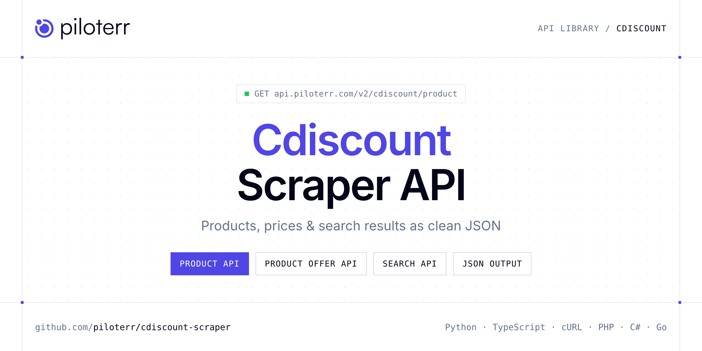

<p align="center">
  <a href="https://www.piloterr.com"></a>
</p>

# Cdiscount Scraper API

[](https://discord.gg/CFj3ph8aHU) [](https://app.piloterr.com) [](https://app.piloterr.com/openapi) [](LICENSE)

The **Piloterr Cdiscount Scraper API** lets you extract public data from Cdiscount as **clean, structured JSON** — no proxies, headless browsers or HTML parsing to maintain. Endpoints available in production:

- **Cdiscount Product API** — Extract full product details from a Cdiscount product page, including price, seller, ratings, specifications, and offers.
- **Cdiscount Product Offer API** — Retrieve all marketplace seller offers for a Cdiscount product, including prices, seller ratings, shipping costs, and availability.
- **Cdiscount Search API** — Extract product listings from Cdiscount search results or category pages for market intelligence and competitive analysis.

Use it for price monitoring, assortment tracking, competitor analysis, product research or catalog enrichment.

| Endpoint | Path | Credits | What you get |
|---|---|---|---|
| [Cdiscount Product API](#cdiscount-product-api) | `/v2/cdiscount/product` | 2 | Extract full product details from a Cdiscount product page, including price, seller, ratings, specifications, and offers. |
| [Cdiscount Product Offer API](#cdiscount-product-offer-api) | `/v2/cdiscount/product/offer` | 2 | Retrieve all marketplace seller offers for a Cdiscount product, including prices, seller ratings, shipping costs, and availability. |
| [Cdiscount Search API](#cdiscount-search-api) | `/v2/cdiscount/search` | 2 | Extract product listings from Cdiscount search results or category pages for market intelligence and competitive analysis. |

## Table of contents

- [How it works](#how-it-works)
- [Cdiscount Product API](#cdiscount-product-api)
- [Cdiscount Product Offer API](#cdiscount-product-offer-api)
- [Cdiscount Search API](#cdiscount-search-api)
- [Code examples in other languages](#code-examples-in-other-languages)
- [Practical use cases](#practical-use-cases)
- [Why Piloterr?](#why-piloterr)
- [FAQ](#faq)
- [Related scrapers](#related-scrapers)
- [Support](#support)

## How it works

1. **Create a free Piloterr account** and copy your API key from the [dashboard](https://app.piloterr.com).
2. **Send a `GET` (or `POST`) request** to `https://api.piloterr.com/v2/...` with the header `x-api-key: YOUR_API_KEY`.
3. **Receive structured JSON** — Piloterr handles rendering, proxies, retries and parsing.

```bash
export PILOTERR_API_KEY="your-api-key"
pip install requests        # Python
# TypeScript: Node.js 18+ (native fetch), run with `npx tsx file.ts`
```

> Every endpoint accepts both `GET` (query string) and `POST` (JSON body with the same fields).

## Cdiscount Product API

Extract full product details from a Cdiscount product page, including price, seller, ratings, specifications, and offers.

`GET | POST https://api.piloterr.com/v2/cdiscount/product` · **2 credits per request** · [Full reference](https://app.piloterr.com/openapi)

### Request parameters

| Parameter | Type | Required | Description |
|---|---|---|---|
| `query` | string | ✅ | Full Cdiscount product page URL. |

### Python example

```python
import json
import os
import requests

response = requests.get(
    "https://api.piloterr.com/v2/cdiscount/product",
    headers={"x-api-key": os.environ["PILOTERR_API_KEY"]},
    params={
        "query": "https://www.cdiscount.com/informatique/ordinateurs-pc-portables/acemagic-pc-portables-gaming/f-1070992-aaaph06865.html",
    },
    timeout=60,
)
response.raise_for_status()
data = response.json()

print(json.dumps(data, indent=2, ensure_ascii=False)[:2000])
```

### TypeScript example

```typescript
type CdiscountProduct = {
  id?: string;
  ean?: string;
  url?: string;
  brand?: string;
  price?: number;
  title?: string;
  images?: string[];
  rating?: number;
  seller?: {
    id?: number;
    name?: string;
    rating?: number;
    sales_count?: number;
    reviews_count?: number;
  };
  is_cdav?: boolean;
  currency?: string;
  offer_id?: number;
  condition?: string;
  description?: string;
  is_available?: boolean;
  other_offers?: {
    total_offers?: number;
    lowest_price_new?: number;
    new_offers_count?: number;
    lowest_price_used?: unknown;
    used_offers_count?: number;
  };
  delivery_info?: string;
  reviews_count?: number;
  original_price?: number;
  multiple_offer_url?: string;
  multiple_offer_text?: string;
  multiple_offer_starting_price?: number;
};

const params = new URLSearchParams({
  "query": "https://www.cdiscount.com/informatique/ordinateurs-pc-portables/acemagic-pc-portables-gaming/f-1070992-aaaph06865.html",
});

const response = await fetch(`https://api.piloterr.com/v2/cdiscount/product?${params}`, {
  headers: { "x-api-key": process.env.PILOTERR_API_KEY! },
});
if (!response.ok) throw new Error(`Piloterr error ${response.status}: ${await response.text()}`);

const data = (await response.json()) as CdiscountProduct;

console.log(JSON.stringify(data, null, 2).slice(0, 2000));
```

<details>
<summary><b>POST variant</b></summary>

```http
POST https://api.piloterr.com/v2/cdiscount/product
x-api-key: YOUR_API_KEY
Content-Type: application/json

{"query": "https://www.cdiscount.com/informatique/ordinateurs-pc-portables/acemagic-pc-portables-gaming/f-1070992-aaaph06865.html"}
```
</details>

### Output example

Example response from the API reference, abridged — real values depend on the page you scrape.

```json
{
  "id": "aaaph06865",
  "ean": "0683370375062",
  "url": "https://www.cdiscount.com/informatique/ordinateurs-pc-portables/acemagic-pc-portables-gaming/f-1070992-aaaph06865.html",
  "brand": "ACEMAGIC",
  "price": 429.99,
  "title": "ACEMAGIC PC Portables Gaming - 15.6\" FHD, AMD Ryzen 7 5700U(8C/16T, 4,3GHz),16Go RAM DDR4, 512Go M.2 SSD, WiFi 6, BT5.2, HDMI,Gris",
  "images": [
    "https://www.cdiscount.com/pdt2/8/6/5/1/700x700/aaaph06865/rw/acemagic-pc-portables-gaming.jpg"
  ],
  "rating": 4,
  "seller": {
    "id": 405259,
    "name": "BOOMING",
    "rating": 5,
    "sales_count": 1847,
    "reviews_count": 20
  },
  "is_cdav": true,
  "currency": "EUR",
  "offer_id": 4258700481,
  "condition": "Neuf",
  "description": "Portable gaming AMD Ryzen 7 5700U, 16Go RAM, 512Go SSD.",
  "is_available": true,
  "other_offers": {
    "total_offers": 1,
    "lowest_price_new": 459.9,
    "new_offers_count": 1,
    "lowest_price_used": null,
    "used_offers_count": 0
  },
  "delivery_info": "Livraison gratuite | Expédié depuis: FRANCE",
  "reviews_count": 2,
  "original_price": 499.9,
  "multiple_offer_url": "https://www.cdiscount.com/mp-352880-auc3283981039048.html",
  "multiple_offer_text": "2 offres neuves",
  "multiple_offer_starting_price": 9.24
}
```

### Response fields

| Field | Type | Description |
|---|---|---|
| `id` | string |  |
| `ean` | string |  |
| `url` | string |  |
| `brand` | string |  |
| `price` | number |  |
| `title` | string |  |
| `images` | string[] |  |
| `rating` | integer |  |
| `seller` | object |  |
| `seller.id` | integer |  |
| `seller.name` | string |  |
| `seller.rating` | integer |  |
| `seller.sales_count` | integer |  |
| `seller.reviews_count` | integer |  |
| `is_cdav` | boolean |  |
| `currency` | string |  |
| `offer_id` | integer |  |
| `condition` | string |  |
| `description` | string |  |
| `is_available` | boolean |  |
| `other_offers` | object |  |
| `other_offers.total_offers` | integer |  |
| `other_offers.lowest_price_new` | number |  |
| `other_offers.new_offers_count` | integer |  |
| `other_offers.lowest_price_used` | object |  |

## Cdiscount Product Offer API

Retrieve all marketplace seller offers for a Cdiscount product, including prices, seller ratings, shipping costs, and availability.

`GET | POST https://api.piloterr.com/v2/cdiscount/product/offer` · **2 credits per request** · [Full reference](https://app.piloterr.com/openapi)

### Request parameters

| Parameter | Type | Required | Description |
|---|---|---|---|
| `query` | string | ✅ | Cdiscount product offer page URL. Pass the `multiple_offer_url` value returned by the Cdiscount Product API. |

### Python example

```python
import json
import os
import requests

response = requests.get(
    "https://api.piloterr.com/v2/cdiscount/product/offer",
    headers={"x-api-key": os.environ["PILOTERR_API_KEY"]},
    params={
        "query": "https://www.cdiscount.com/mp-352880-auc3283981039048.html",
    },
    timeout=60,
)
response.raise_for_status()
data = response.json()

print(json.dumps(data, indent=2, ensure_ascii=False)[:2000])
```

### TypeScript example

```typescript
type CdiscountProductOffer = {
  results?: {
    price?: number;
    seller?: {
      url?: string;
      name?: string;
      type?: string;
      rating?: Record<string, unknown>;
      sales_count?: number;
    };
    condition?: string;
    shipped_by?: string;
    availability?: string;
    delivery_time?: string;
    shipping_cost?: string;
    shipping_country?: string;
  }[];
};

const params = new URLSearchParams({
  "query": "https://www.cdiscount.com/mp-352880-auc3283981039048.html",
});

const response = await fetch(`https://api.piloterr.com/v2/cdiscount/product/offer?${params}`, {
  headers: { "x-api-key": process.env.PILOTERR_API_KEY! },
});
if (!response.ok) throw new Error(`Piloterr error ${response.status}: ${await response.text()}`);

const data = (await response.json()) as CdiscountProductOffer;

console.log(JSON.stringify(data, null, 2).slice(0, 2000));
```

<details>
<summary><b>POST variant</b></summary>

```http
POST https://api.piloterr.com/v2/cdiscount/product/offer
x-api-key: YOUR_API_KEY
Content-Type: application/json

{"query": "https://www.cdiscount.com/mp-352880-auc3283981039048.html"}
```
</details>

### Output example

Example response from the API reference, abridged — real values depend on the page you scrape.

```json
{
  "results": [
    {
      "price": 8.68,
      "seller": {
        "url": "https://www.cdiscount.com/mpv-1818-brico-travo.html",
        "name": "brico-travo",
        "type": "VENDEUR PRO",
        "rating": {},
        "sales_count": 16152
      },
      "condition": "Neuf",
      "shipped_by": "brico-travo",
      "availability": "En Stock !",
      "delivery_time": "Entre le 10/04 et le 15/04",
      "shipping_cost": "6,99€",
      "shipping_country": "FRANCE"
    },
    {
      "price": 8.19,
      "seller": {
        "url": "https://www.cdiscount.com/mpv-406441-NMA.html",
        "name": "NMA",
        "type": "VENDEUR PRO",
        "rating": {},
        "sales_count": 348
      },
      "condition": "Neuf",
      "shipped_by": "NMA",
      "availability": "En Stock !",
      "delivery_time": "Entre le 02/04 et le 08/04",
      "shipping_cost": "8,81€",
      "shipping_country": "FRANCE"
    }
  ]
}
```

### Response fields

| Field | Type | Description |
|---|---|---|
| `results[]` | object[] |  |
| `results[].price` | number |  |
| `results[].seller` | object |  |
| `results[].condition` | string |  |
| `results[].shipped_by` | string |  |
| `results[].availability` | string |  |
| `results[].delivery_time` | string |  |
| `results[].shipping_cost` | string |  |
| `results[].shipping_country` | string |  |

## Cdiscount Search API

Extract product listings from Cdiscount search results or category pages for market intelligence and competitive analysis.

`GET | POST https://api.piloterr.com/v2/cdiscount/search` · **2 credits per request** · [Full reference](https://app.piloterr.com/openapi)

### Request parameters

| Parameter | Type | Required | Description |
|---|---|---|---|
| `query` | string | ✅ | Cdiscount search results page URL. Use any URL from a search or category browse on cdiscount.com. |

### Python example

```python
import json
import os
import requests

response = requests.get(
    "https://api.piloterr.com/v2/cdiscount/search",
    headers={"x-api-key": os.environ["PILOTERR_API_KEY"]},
    params={
        "query": "https://www.cdiscount.com/search/10/laptop.html",
    },
    timeout=60,
)
response.raise_for_status()
data = response.json()

print(json.dumps(data, indent=2, ensure_ascii=False)[:2000])
```

### TypeScript example

```typescript
type CdiscountSearch = {
  results?: {
    id?: string;
    url?: string;
    image?: string;
    price?: number;
    title?: string;
    images?: string[];
    is_new?: boolean;
    rating?: number;
    seller?: {
      id?: number;
      name?: string;
    };
    is_cdav?: boolean;
    brand_id?: number;
    currency?: string;
    offer_id?: number;
    condition?: string;
    category_id?: number;
    is_sponsored?: boolean;
    min_quantity?: number;
    category_path?: string;
    department_id?: number;
    free_shipping?: boolean;
    reviews_count?: number;
    original_price?: number;
    new_offer_quantity?: number;
    new_offer_min_price?: number;
    used_offer_quantity?: number;
    [key: string]: unknown;
  }[];
  pagination?: {
    next?: number;
    current?: number;
    other_pages?: number[];
    total_pages?: number;
    has_next_page?: boolean;
  };
};

const params = new URLSearchParams({
  "query": "https://www.cdiscount.com/search/10/laptop.html",
});

const response = await fetch(`https://api.piloterr.com/v2/cdiscount/search?${params}`, {
  headers: { "x-api-key": process.env.PILOTERR_API_KEY! },
});
if (!response.ok) throw new Error(`Piloterr error ${response.status}: ${await response.text()}`);

const data = (await response.json()) as CdiscountSearch;

console.log(JSON.stringify(data, null, 2).slice(0, 2000));
```

<details>
<summary><b>POST variant</b></summary>

```http
POST https://api.piloterr.com/v2/cdiscount/search
x-api-key: YOUR_API_KEY
Content-Type: application/json

{"query": "https://www.cdiscount.com/search/10/laptop.html"}
```
</details>

### Output example

Example response from the API reference, abridged — real values depend on the page you scrape.

```json
{
  "results": [
    {
      "id": "aaaph06865",
      "url": "https://www.cdiscount.com/informatique/ordinateurs-pc-portables/acemagic-pc-portables-gaming/f-1070992-aaaph06865.html",
      "image": "https://www.cdiscount.com/pdt2/8/6/5/1/300x300/aaaph06865/rw/acemagic-pc-portables-gaming.jpg",
      "price": 429.99,
      "title": "ACEMAGIC PC Portables Gaming - 15.6\" FHD, AMD Ryzen 7 5700U, 16Go RAM, 512Go SSD",
      "images": [
        "https://www.cdiscount.com/pdt2/8/6/5/1/300x300/aaaph06865/rw/acemagic-pc-portables-gaming.jpg",
        "https://www.cdiscount.com/pdt2/8/6/5/1/140x140/aaaph06865/rw/acemagic-pc-portables-gaming.jpg"
      ],
      "is_new": true,
      "rating": 4,
      "seller": {
        "id": 405259,
        "name": "BOOMING"
      },
      "is_cdav": true,
      "brand_id": 221204,
      "currency": "EUR",
      "offer_id": 4258700481,
      "condition": "Neuf",
      "category_id": 1000004592,
      "is_sponsored": false,
      "min_quantity": 1,
      "category_path": "0K/0K07/0K0701/0K070101",
      "department_id": 1070992,
      "free_shipping": true,
      "reviews_count": 2,
      "original_price": 499.9,
      "new_offer_quantity": 0,
      "new_offer_min_price": 0,
      "used_offer_quantity": 0
    },
    {
      "id": "aaaaq86960",
      "url": "https://www.cdiscount.com/informatique/ordinateurs-pc-portables/ordinateur-portable-laptop-hp/f-1070992-aaaaq86960.html",
      "image": "https://www.cdiscount.com/pdt2/9/6/0/1/300x300/aaaaq86960/rw/ordinateur-portable-laptop-hp.jpg",
      "price": 759.99,
      "title": "ORDINATEUR PORTABLE LAPTOP HP 15-EH3001SF RAM 16 Go SSD 512 Go - ARGENT NATUREL",
      "images": [
        "https://www.cdiscount.com/pdt2/9/6/0/1/300x300/aaaaq86960/rw/ordinateur-portable-laptop-hp.jpg",
        "https://www.cdiscount.com/pdt2/9/6/0/1/140x140/aaaaq86960/rw/ordinateur-portable-laptop-hp.jpg"
      ],
      "is_new": true,
      "seller": {
        "id": 80174,
        "name": "MegaMarket"
      },
      "is_cdav": true,
      "brand_id": 766,
      "currency": "EUR",
      "offer_id": 4213440156,
      "condition": "Neuf",
      "category_id": 1000004592,
      "is_sponsored": false,
      "min_quantity": 1,
      "category_path": "0K/0K07/0K0701/0K070101",
      "department_id": 1070992,
      "free_shipping": true,
      "original_price": 999.99,
      "new_offer_quantity": 0,
      "new_offer_min_price": 0,
      "used_offer_quantity": 0,
      "used_offer_min_price": 0
    }
  ],
  "pagination": {
    "next": 2,
    "current": 1,
    "other_pages": [
      2
    ],
    "total_pages": 2,
    "has_next_page": true
  }
}
```

### Response fields

| Field | Type | Description |
|---|---|---|
| `results[]` | object[] |  |
| `results[].id` | string |  |
| `results[].url` | string |  |
| `results[].image` | string |  |
| `results[].price` | number |  |
| `results[].title` | string |  |
| `results[].images` | string[] |  |
| `results[].is_new` | boolean |  |
| `results[].rating` | integer |  |
| `results[].seller` | object |  |
| `results[].is_cdav` | boolean |  |
| `results[].brand_id` | integer |  |
| `results[].currency` | string |  |
| `results[].offer_id` | integer |  |
| `results[].condition` | string |  |
| `results[].category_id` | integer |  |
| `results[].is_sponsored` | boolean |  |
| `results[].min_quantity` | integer |  |
| `results[].category_path` | string |  |
| `results[].department_id` | integer |  |
| `results[].free_shipping` | boolean |  |
| `results[].reviews_count` | integer |  |
| `results[].original_price` | number |  |
| `results[].new_offer_quantity` | integer |  |
| `results[].new_offer_min_price` | integer |  |

## Code examples in other languages

Ready-to-run examples live in the [`examples/`](examples) folder. Each one reads your key from the `PILOTERR_API_KEY` environment variable.

| Language | Product | Product Offer | Search |
|---|---|---|---|
| cURL (Bash) | [`product`](examples/curl/product.sh) | [`product-offer`](examples/curl/product_offer.sh) | [`search`](examples/curl/search.sh) |
| PHP | [`product`](examples/php/product.php) | [`product-offer`](examples/php/product_offer.php) | [`search`](examples/php/search.php) |
| C# | [`product`](examples/csharp/Product.cs) | [`product-offer`](examples/csharp/ProductOffer.cs) | [`search`](examples/csharp/Search.cs) |
| Go | [`product`](examples/go/product.go) | [`product-offer`](examples/go/product_offer.go) | [`search`](examples/go/search.go) |
| Java | [`product`](examples/java/ProductExample.java) | [`product-offer`](examples/java/ProductOfferExample.java) | [`search`](examples/java/SearchExample.java) |
| Ruby | [`product`](examples/ruby/product.rb) | [`product-offer`](examples/ruby/product_offer.rb) | [`search`](examples/ruby/search.rb) |
| Node.js | [`product`](examples/nodejs/product.mjs) | [`product-offer`](examples/nodejs/product_offer.mjs) | [`search`](examples/nodejs/search.mjs) |

## Practical use cases

- **Price monitoring** — Track prices, promotions and availability over time to react to competitors.
- **Assortment & catalog tracking** — Follow new products, delisted items and category changes.
- **Competitor analysis** — Benchmark ranges, brands and positioning across retailers.
- **Product research** — Spot best-sellers and trends from search results.
- **Catalog enrichment** — Pull titles, images and attributes into your PIM or marketplace listings.

## Why Piloterr?

- **No infrastructure** — no proxies, headless browsers or CAPTCHA solving to run yourself.
- **Structured JSON** — stable, documented fields instead of brittle HTML selectors.
- **Pay per request** — transparent credit cost per endpoint, failed requests are retried for you.
- **One API key, hundreds of sources** — Cdiscount plus many other e-commerce, search and company data endpoints in the [Piloterr library](https://www.piloterr.com/library).
- **Any language** — plain HTTPS + JSON, with examples for Python, TypeScript, cURL, PHP, C#, Go, Java, Ruby and Node.js.

## FAQ

### Is it legal to scrape Cdiscount?

Collecting publicly available data is generally allowed in many jurisdictions, but rules depend on your country, the data you collect and how you use it. Avoid personal data unless you have a lawful basis, respect the website's terms where they apply, and get legal advice for your specific use case. This is not legal advice.

### Do I need proxies or a headless browser?

No. Piloterr handles rendering, proxy rotation and retries on its side. You only send an HTTPS request with your `x-api-key` header and receive JSON.

### How much does a request cost?

Credits per call: `/v2/cdiscount/product` **2**, `/v2/cdiscount/product/offer` **2**, `/v2/cdiscount/search` **2**. See the [Piloterr website](https://www.piloterr.com) for plans.

### What data does the Cdiscount API return?

Each endpoint returns structured JSON: **Cdiscount Product** — `id`, `ean`, `url`, `brand`, `price`, `title`; **Cdiscount Product Offer** — `results[]`, `results[].price`, `results[].seller`, `results[].condition`, `results[].shipped_by`, `results[].availability`; **Cdiscount Search** — `results[]`, `results[].id`, `results[].url`, `results[].image`, `results[].price`, `results[].title`.

### Which languages are supported?

Any language that can make an HTTP request. This README shows Python and TypeScript; the [`examples/`](examples) folder contains cURL, PHP, C#, Go, Java, Ruby and Node.js.

## Related scrapers

- [About You Scraper API](https://github.com/piloterr/aboutyou-scraper)
- [Action Scraper API](https://github.com/piloterr/action-scraper)
- [Aldi Scraper API](https://github.com/piloterr/aldi-scraper)
- [Alibaba Scraper API](https://github.com/piloterr/alibaba-scraper)
- [AliExpress Scraper API](https://github.com/piloterr/aliexpress-scraper)
- [Allegro Scraper API](https://github.com/piloterr/allegro-scraper)
- [All Piloterr scrapers on GitHub](https://github.com/piloterr)

## Support

- 💬 Join the [Piloterr Discord](https://discord.gg/CFj3ph8aHU) to ask questions and share what you build.
- 📚 Browse the [API reference (OpenAPI)](https://app.piloterr.com/openapi) and the [Piloterr library](https://www.piloterr.com/library).
- 🔑 [Get your API key](https://app.piloterr.com).

---

<p align="center">
  <a href="https://www.piloterr.com">
    <picture>
      <source media="(prefers-color-scheme: dark)" srcset="images/logo-dark.svg">
      
    </picture>
  </a>
  <br>
  <sub>Built by <a href="https://www.piloterr.com">Piloterr</a> — web scraping APIs for e-commerce, search, real estate and more, one API key.</sub>
</p>

<sub>Cdiscount is a trademark of its respective owner. This repository is not affiliated with or endorsed by Cdiscount. Examples are released under the MIT license.</sub>
